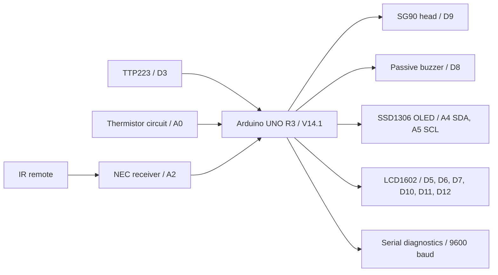
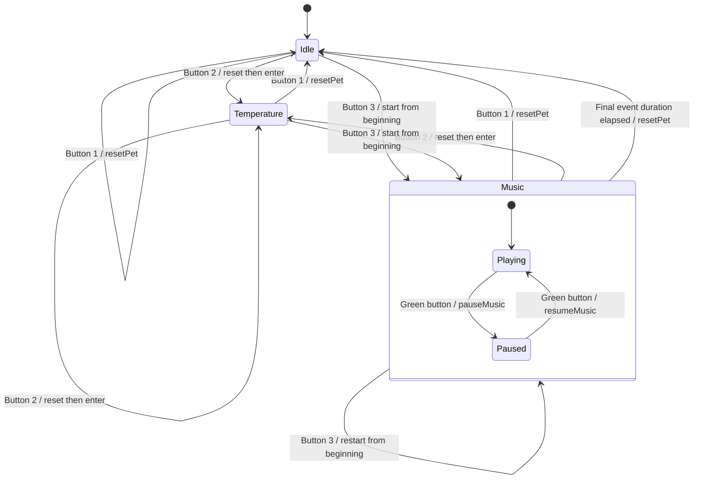
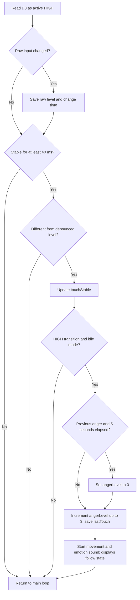
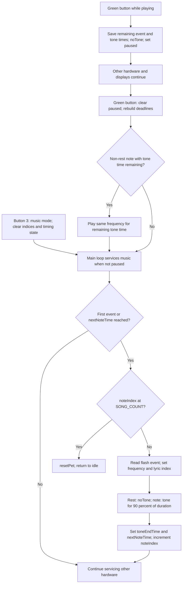

# System Design — V14.1

The sketch is the behavioral reference. Diagrams describe source logic; they are not measured circuit schematics or evidence of physical testing.

## 1. Overall system

Power distribution is deliberately unspecified; see [Wiring](wiring.md).

## 2. Operating modes

`musicPaused` is a flag within `MODE_MUSIC`, not a fourth `PetMode`. The green button has no action in idle or temperature mode. Temperature sampling and debounced touch-state tracking continue across modes; only idle accepts touch-triggered emotion actions. Reset changes software state and schedules head centering without restarting the UNO. It does not clear the temperature filter/history or reinitialize the peripherals.

## 3. Touch-to-emotion processing

An additional idle-loop condition clears anger when touch is released and five seconds have elapsed since the last accepted touch. A held touch does not repeatedly increase anger and prevents the idle-loop calm transition. A new touch after the timeout restarts escalation at level 1. A new movement/sound request replaces the earlier sequence rather than queuing it.

| Emotion | Head targets in degrees | Emotion tones |
| --- | --- | --- |
| Calm (0) | 90 | No new emotion sound |
| Slightly angry (1) | 65 → 90 | 350 Hz |
| Angry (2) | 65 → 115 → 90 | 500, 400 Hz |
| Very angry (3) | 60 → 120 → 60 → 120 → 90 | 900, 700, 500 Hz |

Each tone lasts 130 ms, with successive tone starts scheduled 200 ms apart. Servo software position changes by one degree per eligible 18 ms update, is constrained to 60°–120°, and waits 150 ms at each target. Anger increases sequence range and repetition; it does not change the degree-step interval. Actual shaft position is not sensed.

## 4. Music and pause/resume

`SongNote` stores frequency, beat count and lyric phrase index in flash. One beat is 400 ms. Each non-rest event sounds for 90% of its event duration, leaving a gap. `noteIndex` points to the next event after the current event starts. Lyrics change at phrase indices, not by word recognition. Pausing preserves both the event deadline and its sounding portion; a pause in a gap or rest resumes silently until the next event. If playback has not yet started, resume leaves the first event ready to begin.

## Cooperative scheduling

Each loop captures one `now = millis()` and calls remote, touch and servo services in that order. It samples temperature when 250 ms have elapsed, advances unpaused music or idle emotion sounds, checks the idle calm timeout, refreshes LCD state and schedules OLED rendering every 100 ms.

These are minimum scheduling intervals, not guaranteed precise periods. The loop does not catch up all missed servo steps or notes after a slow iteration. Eight ADC conversions, LCD writes, I2C page transfers and Serial output still occupy processor time. IR decoding uses TinyIRReceiver's interrupt-based reception; no additional full IR receiver or timer-based scheduler was introduced.

The original LCD code already caches the last mode, anger, lyric, temperature, hot state and pause flag. It rewrites padded rows when those values change. No V14.2 changes or per-character caching are included.
